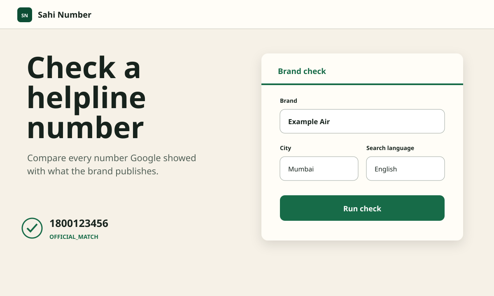
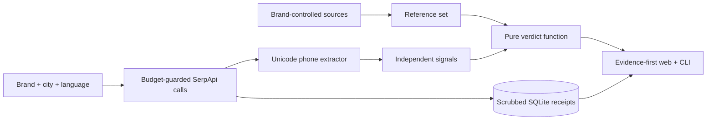

# Sahi Number

Sahi Number helps a person in India check whether a customer-care number shown by Google is also published by the relevant brand.



## The problem

People often search Google for a helpline while handling a refund, failed recharge, appointment, or booking. Search results, ads, and edited listings can surface phone numbers that are not published by the brand. The usual advice—cross-check the official website—is mechanical, so Sahi Number performs that comparison while preserving the limits of the evidence.

## How it works



There is no language model in the runtime. Phone extraction, signals, and the four-state verdict are deterministic code covered by offline tests.

### Which check should I use?

**Brand Check** starts with a brand and a place. Use it when you want to see the
numbers Google shows for a local business or branch, then compare every number
against trusted references. For example: `SBI Bank Valavoor` in `Valavoor,
Kerala`.

**Number Check** starts with one number. Use it when a caller, ad, or search
result has already given you a number and you want to see where it appears, and
optionally compare it with a named brand. A number can be formatted as a normal
Indian landline (such as `0482-2258058`) or international form; the application
stores one canonical identity but displays it in a readable format.

## How SerpApi is used

The search results page is the object being audited—not merely a way to find another data source.

| Engine/API | Parameters used | One job |
|---|---|---|
| [Google Search](https://serpapi.com/search-api) | `q`, `location`, `hl`, `gl=in`, `google_domain=google.co.in`, `device=mobile` | Collect numbers from organic results, answer boxes, local packs, knowledge graph, related questions, and inline AI answers |
| [Google Ads](https://serpapi.com/google-ads-api) | `q`, `location`, `hl` | Audit paid placements separately from organic results |
| [Google Maps](https://serpapi.com/google-maps-api) | `type=search`, `q`, `ll` or `location` + `z=12`, `hl` | Inspect listing phone, website, address, IDs, and unclaimed status |
| [Maps Reviews](https://serpapi.com/google-maps-reviews-api) | `data_id`, `sort_by=newestFirst`, `hl` | Look for named warning phrases without retaining reviewer identity |
| [Google AI Overview](https://serpapi.com/google-ai-overview-api) | `page_token` | Redeem an expiring AI Overview block when Google supplies a token |
| [Locations](https://serpapi.com/locations-api) | `q`, `limit=5` | Resolve an Indian city, town, or locality to a canonical name and `[longitude, latitude]` |
| Account API | API key only | Guard the monthly reserve and show credits left; this call is free |

Every search response is scrubbed before SQLite persistence. The UI links to a local receipt route, never to a secret-bearing archive URL.

## Verdicts and signals

| Verdict | Meaning |
|---|---|
| `OFFICIAL_MATCH` | Found on the brand's official site or a matching Indian public-authority directory |
| `NOT_CORROBORATED` | Not found on the brand's official site |
| `CONFLICT` | Conflicts with what the brand publishes |
| `CANNOT_VERIFY` | The reference set is unavailable |

Decision order:

| Condition | Verdict |
|---|---|
| Reference set is empty | `CANNOT_VERIFY` |
| Number is in the reference set | `OFFICIAL_MATCH` |
| Number is absent and two or more independent signals fire | `CONFLICT` |
| Otherwise | `NOT_CORROBORATED` |

Signals stay visible and separate: number-type mismatch, listing-domain mismatch, unclaimed listing, ad-domain mismatch, review warning phrases, foreign number, and no official-domain search result. They are never blended into a score.

## Quick start

Prerequisites: Python 3.11 or newer and [uv](https://docs.astral.sh/uv/). From the
repository root, run:

```bash
cp .env.example .env
uv sync --extra dev
uv run uvicorn sahi.web.app:app --reload
uv run sahi check --brand example-air --city Mumbai --lang en
uv run pytest
```

The default `.env.example` uses replay mode, so the app starts with a complete fictional stored check and needs no key. For live use, put the key only in `.env` and set `SERPAPI_MODE=live`.

Open [http://127.0.0.1:8000](http://127.0.0.1:8000). The replay home page and
Example Air check are fully usable offline. SQLite data is created at
`data/sahi.db`; deleting that generated file resets local history.
Keep Uvicorn running in that terminal. Run CLI and test commands in a second
terminal opened at the same repository root.

For live mode, edit only these values in the untracked `.env` file:

```dotenv
SERPAPI_API_KEY=your_key_here
SERPAPI_MODE=live
```

Never put a key in a command, fixture, seed, screenshot, or committed file. Before
checking a real brand, add its hand-verified domain to `seeds/brands.yaml`; leave
`official_numbers` empty unless each number has a fetched `source_url` and
`verified_on` date. A free-text brand is also accepted in the web form and is
marked as using an unconfirmed domain when one is derived from Google's knowledge
graph. The Brand Check place field also accepts free text such as
`Valavoor, Kerala`; its suggestions are only shortcuts. Sahi asks SerpApi's
Locations API for the closest Indian match, so very small or ambiguous localities
may need a district or state suffix.

Useful commands:

```bash
uv run sahi account
uv run sahi locations resolve
uv run sahi number "1800 123 456" --brand example-air
uv run sahi sweep --brands all --cities Mumbai,Delhi --langs en,hi --budget 40 --yes
uv run sahi fixtures export --check CHECK_ID
```

The capability probe requires a real owner-supplied brand and is hard-capped at
ten searches:

```bash
uv run sahi probe --brand "OWNER-SUPPLIED BRAND" --cities Mumbai,Delhi --langs en,hi
```

If port 8000 is occupied, append `--port 8765` to the Uvicorn command and open
that port instead. To stop the server, press `Ctrl+C`.

## Credits, cache, and replay

A brand check uses up to `MAX_SEARCHES_PER_CHECK` (default 8). Search, official-site lookup, Maps, optional Ads, and a public-directory search run first; number searches, review lookup, and AI Overview redemption use only the remaining cap. Local cache hits cost nothing; official-site and public-directory searches are cached for 24 hours. The guard refuses calls at the hourly limit or below `MIN_CREDITS_RESERVE`. Replay mode never touches the network and raises a visible replay miss when no matching receipt exists.

## Limits

An absent number is not proof of wrongdoing, branch/dealer numbers may be missing from head-office pages, and one city/language/device snapshot is incomplete. Read the complete [limitations](docs/LIMITS.md).

## Tests

```bash
uv run ruff check .
uv run pytest
```

The suite covers 40+ phone cases, walker exclusions, every decision boundary, all signals, cache/replay/budget behavior, the full replay pipeline, number checks, resumable sweeps, fixture scrubbing, and every web route. CI runs the same gates without a key.

## AI tools used during development and licence

OpenAI Codex assisted with implementation and test generation. Context7 was used for current FastAPI documentation, Firecrawl for current official SerpApi engine documentation, ECC/browser automation for UI validation, and the Superpowers, Matt Pocock Skills, and Impeccable workflows for planning, TDD, module design, and interface craft. Runtime behavior contains no LLM call.

Licensed under the [MIT License](LICENSE).
