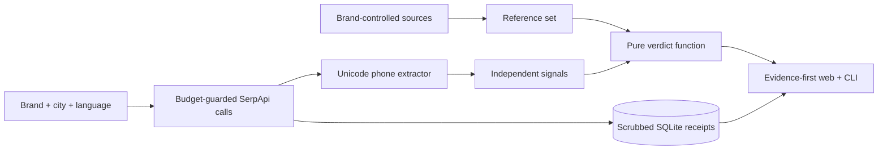

# Sahi Number

Sahi Number helps a person in India check whether a customer-care number shown by Google is also published by the relevant brand.


## The problem

People often search Google for a helpline while handling a refund, failed recharge, appointment, or booking. Search results, ads, and edited listings can surface phone numbers that are not published by the brand. The usual advice—cross-check the official website—is mechanical, so Sahi Number performs that comparison while preserving the limits of the evidence.

## How it works



There is no language model in the runtime. Phone extraction, signals, and the four-state verdict are deterministic code covered by offline tests.

### Which check should I use?

**Brand Check** starts with a brand and a place. Use it when you want to see the
numbers Google shows for a local business or branch, then compare every number
against trusted references. For example: `SBI Bank Valavoor` in `Valavoor,
Kerala`.

**Number Check** starts with one number. Use it when a caller, ad, or search
result has already given you a number and you want to see where it appears, and
optionally compare it with a named brand. A number can be formatted as a normal
Indian landline (such as `0482-2258058`) or international form; the application
stores one canonical identity but displays it in a readable format and labels it
as landline, mobile, toll-free, shared-cost/UAN, short code, or international.
If the initial exact-variant query is empty, Number Check retries the familiar
unquoted local format and a contact-context query. When a brand is supplied it
also tries a brand-qualified number query so Google does not mistake an STD code
for a train or other ID.

### A typical user journey

1. Choose **Brand Check** or **Number Check**.
2. Enter a brand, number, and optional Indian city or locality.
3. Select a suggested canonical location when one is available.
4. Run the check and review the number type, domains, source labels, signals, and verdict.
5. Open a saved search receipt to see the exact query, location, language, status, timestamp, and result evidence.
6. Use the “How to check this evidence” instructions and confirm the number from the organisation’s official website, app, card, or bill.

The form accepts free-text brands and localities. Suggestions are shortcuts, not
requirements. A small locality with no canonical Locations API match is searched
using its place words, and that limitation is shown to the user.

## How SerpApi is used

The search results page is the object being audited—not merely a way to find another data source.

| Engine/API | Parameters used | One job |
|---|---|---|
| [Google Search](https://serpapi.com/search-api) | `q`, `location`, `hl`, `gl=in`, `google_domain=google.co.in`, `device=mobile` | Collect numbers from organic results, answer boxes, local packs, knowledge graph, related questions, and inline AI answers |
| [Google Ads](https://serpapi.com/google-ads-api) | `q`, `location`, `hl` | Audit paid placements separately from organic results |
| [Google Maps](https://serpapi.com/google-maps-api) | `type=search`, `q`, `ll` or `location` + `z=12`, `hl` | Inspect listing phone, website, address, IDs, and unclaimed status |
| [Maps Reviews](https://serpapi.com/google-maps-reviews-api) | `data_id`, `sort_by=newestFirst`, `hl` | Look for named warning phrases without retaining reviewer identity |
| [Google AI Overview](https://serpapi.com/google-ai-overview-api) | `page_token` | Redeem an expiring AI Overview block when Google supplies a token |
| [Locations](https://serpapi.com/locations-api) | `q`, `limit=5` | Resolve an Indian city, town, or locality to a canonical name and `[longitude, latitude]` |
| Account API | API key only | Guard the monthly reserve and show credits left; this call is free |

Every search response is scrubbed before SQLite persistence. The UI links to a local receipt route, never to a secret-bearing archive URL.

### Why API results can differ from a personal Google search

Sahi Number audits the response returned by SerpAPI, not the private Google
session open in a user’s browser. Google can personalise a browser result using
location, device, history, cookies, and current ranking signals. If an API query
has no location, SerpAPI may use the proxy’s location. For local numbers, enter
a city or locality such as `Kottayam, Kerala, India` to make the API search more
comparable to a local browser search.

Number searches are deliberately staged: the exact number is searched first,
then the correct local formatting, then a contact-context query. The application
does not use a broad `OR` query containing every formatting variant, because
Google can interpret that as unrelated product codes or identifiers. The query
parameters also request unfiltered results and disable automatic query rewriting.

This improves recall, but it cannot guarantee that a remote API session will
return every result visible in a person’s browser. A result that is absent from
the SerpAPI response cannot be reconstructed by the extractor; the receipt makes
that distinction visible.

## Verdicts and signals

| Verdict | Meaning |
|---|---|
| `OFFICIAL_MATCH` | Found on the brand's official site or a matching Indian public-authority directory |
| `NOT_CORROBORATED` | Not found on the brand's official site |
| `CONFLICT` | Conflicts with what the brand publishes |
| `CANNOT_VERIFY` | The reference set is unavailable |

Trusted reference sources are deliberately limited to a brand's configured
official domain, Indian public-authority domains (`.gov.in`, `.nic.in`), and
the small statutory/national-infrastructure allowlist in
`seeds/trusted_sources.yaml` (RBI, SEBI, IRDAI, PFRDA, NPCI, TRAI, and UIDAI).
Commercial directories are shown as appearances only and never turn a result
into a match. Their result titles are shown separately as search-result claims,
so the likely entity is visible without incorrectly labelling it verified. To
add another source, review who controls the domain and whether
it publishes the relevant contact data, then add the domain to that allowlist;
do not add search aggregators, review platforms, or social networks.

Decision order:

| Condition | Verdict |
|---|---|
| Reference set is empty | `CANNOT_VERIFY` |
| Number is in the reference set | `OFFICIAL_MATCH` |
| Number is absent and two or more independent signals fire | `CONFLICT` |
| Otherwise | `NOT_CORROBORATED` |

Signals stay visible and separate: number-type mismatch, listing-domain mismatch, unclaimed listing, ad-domain mismatch, review warning phrases, foreign number, and no official-domain search result. They are never blended into a score.

## Search receipts and plain-language evidence

Each search is stored in SQLite as a scrubbed receipt. The receipt page is
written for ordinary citizens first and technical reviewers second. It explains:

- what service was searched;
- the exact search words and location;
- the language, status, and time of the search;
- which phone number appeared in each result;
- the result title, website, and surface where it appeared; and
- how a person can verify the number independently.

Raw parameters and the scrubbed response remain available inside a collapsed
**Advanced technical details** section. Search-result titles and commercial
directory appearances are shown as claims or sightings, not as official proof.

The web interface includes English and Hindi copy, semantic headings and lists,
visible keyboard focus, large readable links, responsive reflow, and clear
source labels. The project’s detailed two-person demo script is available at
[`docs/PRESENTATION-SCRIPT.md`](docs/PRESENTATION-SCRIPT.md).

## Trust and safety model

Sahi Number is evidence software, not a safety guarantee. Users should never
share an OTP, PIN, password, card CVV, or remote-access code with an unexpected
caller. When in doubt, use the number printed on an official card, bill, or
inside the brand’s official app. In India, suspected cyber fraud can be reported
by calling `1930` or visiting [cybercrime.gov.in](https://cybercrime.gov.in/).

The project does not treat a missing number as proof of wrongdoing. Branch
numbers can be absent from a head-office page, directories can be outdated, and
one search snapshot is incomplete.

## Quick start

Prerequisites: Python 3.11 or newer and [uv](https://docs.astral.sh/uv/). From the
repository root, run:

```bash
cp .env.example .env
uv sync --extra dev
uv run uvicorn sahi.web.app:app --reload --port 8765
uv run sahi check --brand example-air --city Mumbai --lang en
uv run pytest
```

The default `.env.example` uses replay mode, so the app starts with a complete fictional stored check and needs no key. For live use, put the key only in `.env` and set `SERPAPI_MODE=live`.

Open [http://127.0.0.1:8765](http://127.0.0.1:8765). The replay home page and
Example Air check are fully usable offline. SQLite data is created at
`data/sahi.db`; deleting that generated file resets local history.
Keep Uvicorn running in that terminal. Run CLI and test commands in a second
terminal opened at the same repository root.

For live mode, edit only these values in the untracked `.env` file:

```dotenv
SERPAPI_API_KEY=your_key_here
SERPAPI_MODE=live
```

Never put a key in a command, fixture, seed, screenshot, or committed file. Before
checking a real brand, add its hand-verified domain to `seeds/brands.yaml`; leave
`official_numbers` empty unless each number has a fetched `source_url` and
`verified_on` date. A free-text brand is also accepted in the web form and is
marked as using an unconfirmed domain when one is derived from Google's knowledge
graph. The Brand Check place field also accepts free text such as
`Valavoor, Kerala`; its suggestions are only shortcuts. Sahi asks SerpApi's
Locations API as the user types and again at submission, so very small or ambiguous localities
may need a district or state suffix. If SerpApi has no canonical match (for
example, a spelling variant), Sahi does not send that invalid value as a
location parameter: it runs a country-wide query containing the place words and
shows that limitation in the result.

Useful commands:

```bash
uv run sahi account
uv run sahi locations resolve
uv run sahi number "1800 123 456" --brand example-air
uv run sahi sweep --brands all --cities Mumbai,Delhi --langs en,hi --budget 40 --yes
uv run sahi fixtures export --check CHECK_ID
```

The capability probe requires a real owner-supplied brand and is hard-capped at
ten searches:

```bash
uv run sahi probe --brand "OWNER-SUPPLIED BRAND" --cities Mumbai,Delhi --langs en,hi
```

If port 8765 is occupied, choose another free port, for example
`--port 8000`, and open that matching address. To stop the server, press
`Ctrl+C`.

## Credits, cache, and replay

A brand check uses up to `MAX_SEARCHES_PER_CHECK` (default 8). Search, official-site lookup, Maps, optional Ads, and a public-directory search run first; number searches, review lookup, and AI Overview redemption use only the remaining cap. Local cache hits cost nothing; official-site and public-directory searches are cached for 24 hours. The guard refuses calls at the hourly limit or below `MIN_CREDITS_RESERVE`. Replay mode never touches the network and raises a visible replay miss when no matching receipt exists.

## Limits

An absent number is not proof of wrongdoing, branch/dealer numbers may be missing from head-office pages, and one city/language/device snapshot is incomplete. Read the complete [limitations](docs/LIMITS.md).

## Tests

```bash
uv run ruff check .
uv run pytest
```

The suite covers 40+ phone cases, walker exclusions, every decision boundary, all signals, cache/replay/budget behavior, the full replay pipeline, number checks, resumable sweeps, fixture scrubbing, and every web route. CI runs the same gates without a key.

## Project layout

| Path | Purpose |
|---|---|
| `src/sahi/web/` | FastAPI application, templates, accessibility-focused styles, and location suggestions |
| `src/sahi/serp/` | SerpAPI client, budget guard, cache/replay layer, and engine-specific requests |
| `src/sahi/extract/` | Unicode-aware phone parsing, formatting, classification, and response walking |
| `src/sahi/reference.py` | Official and trusted-source reference collection |
| `src/sahi/signals.py` and `src/sahi/verdict.py` | Independent signals and deterministic four-state verdicts |
| `src/sahi/store.py` | SQLite schema, receipts, checks, sightings, signals, and history |
| `seeds/brands.yaml` | Hand-reviewed brands and official domains |
| `seeds/trusted_sources.yaml` | Approved Indian public-authority and statutory source suffixes |
| `tests/` | Offline unit, integration, replay, web, and regression tests |
| `docs/` | Limits, demo assets, and the presentation script |

## AI tools used during development and licence

OpenAI Codex assisted with implementation and test generation. Context7 was used for current FastAPI documentation, Firecrawl for current official SerpApi engine documentation, ECC/browser automation for UI validation, and the Superpowers, Matt Pocock Skills, and Impeccable workflows for planning, TDD, module design, and interface craft. Runtime behavior contains no LLM call.

Licensed under the [MIT License](LICENSE).
